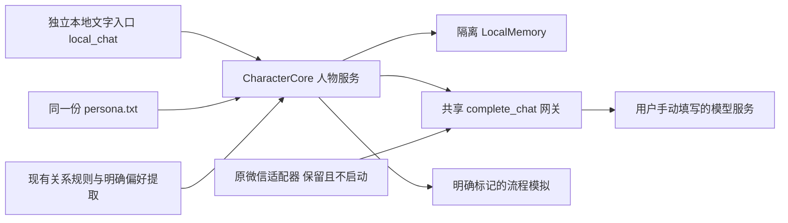

# 小泽第一阶段 · 架构与 ASTRA 复盘材料

日期：2026-11-11。阶段到此交付，不继续微信操作开发。开发角色分工不等于运行配置；未切换当前开发模型，也没有修改既有运行时 API 地址、模型或密钥。

## 当前结构与边界

模型网关位于原 `core.py`，从旧 `ChatModel.reply` 提取为共享 `complete_chat`；原适配器仍调用相同网关。保留既有请求格式、超时、无自动重试及错误正文不回显的行为。`character.py` 不导入 `app.py`、视觉适配器或上游桌面库，不接受微信传输器、工具调用或执行器。导入旧纯定义模块不触发窗口动作。

本地入口没有另建应用仓库，也没有替换旧微信流程：共享人格、网关、OWNER_STYLE/FRIEND_STYLE 和 `explicit_preferences`。旧 PeopleMemory SQLite 保留原样；它把大量发言永久写作证据，没有本阶段需要的近期上限、原文删除和独立本地身份，直接复用会混入真实数据。因此只复用其中合适的小规则，新建隔离的小型 JSON 存储，不读取旧数据库或历史。

## 最小实现

| 对象 | 当前作用 | 限制 |
|---|---|---|
| Person / Scene | 固定本地人物ID、场景ID、当前发言者；群内共享本群对话 | 仅三位测试人物，未对接真实账号ID或显示名解析 |
| CharacterCore | 构造本轮上下文、调用注入的文本生成器、成功后提交一轮 | 提示词约束不能保证任何模型的所有输出都遵守；尚无语义质量拦截器 |
| MemoryPort | snapshot / save_scene 的小型替换接口 | 第二阶段细分召回、候选、确认、过期与删除；当前不引入通用框架 |
| LocalMemory | 每场景12轮近期记录；朋友3类明确表达偏好、证据、来源、时间、不确定性 | 没有长期经历、人物画像推断、相似度检索、TTL或摘要 |
| ApiCompletion | 复用现有兼容接口；配置仅由用户本次输入 | 未测试真实提供方；仍沿用旧网关的 `thinking: disabled`、1024输出token及1800字符截断，兼容性和截断体验需后续实测 |
| DraftCandidate | 预留只有草稿含义的决策输出类型，含作用域、内容、依据轮次 | **仅接口设计**，没有主动决策器、定时器、草稿生成入口或执行回执 |

原 `moments.py` 已有本地朋友圈草稿仍保留，本次仅更新角色提示用名；它不是新主动能力，本地试聊不导入或启动它，不把草稿写入“已发过”的聊天历史。

## 数据归属、提交与遗忘

模型上下文由稳定人格、可信的本机场景关系、当前人物偏好、当前场景近期对话、新发言构成。私聊不查其他私聊或群；群内可以看到本群其他人说过的话，但当前人物偏好不沿用别人的。即便人物ID相同，也不自动跨私聊与群共享资料。未来公开信息共享需要明确授权策略，当前没有共享通道。

固定关系来自 Python 的本机场景注册；用户正文、模型回复和可编辑偏好不能设置 `owner`。昵称只作展示，本地扮演不是身份认证。原微信“孤月大人 / X_A”关系绑定未读取、迁移或扩大适用范围。

存储区分：人物设定在 `persona.txt`；用户原话和生成回复分别存于一轮的 `text` / `reply`；轮次标明 `kind=local_exchange` 和模拟/API来源；偏好标明 `user_explicit` 或 `local_maintainer`，并保留证据节选、轮次ID、时间和不确定性。没有把模型推断写成人物事实，也没有外部执行记录。模拟与模型试聊使用不同文件，避免模板回复污染模型上下文。

一轮流程是“读取快照 → 生成 → 校验当前代次 → 原子保存 → 更新内存”。暂停、清空、修正偏好或另一轮成功提交都会让旧代次作废，避免迟到回复复活已删除内容或覆盖新状态。UI同一时间只允许一个请求，正常启动器再加进程锁。该锁不覆盖绕过启动器直接运行 `local_chat.py` 的做法；使用正式启动器。

失败的用户输入留在输入框，用户原话与回复都不进入正式记录，偏好也不更新。没有自动重试。暂停不强行中断网络连接，旧请求返回后结果丢弃；关闭窗口使在途结果失效。本阶段只对模型API有显式网络调用能力，没有社交外部操作路径。

遗忘的三个不同语义：

- 检索省略：历史发给模型的预算为16,000字符，省略的近期原文仍可能在本地12轮窗口内。不是删除。
- 当前原文移除：超过12轮的最旧原文从本地 JSON 移除；清空场景移除该场景原文及偏好。没有生成摘要，没有承诺服务端或备份删除。
- 偏好删除：删除独立偏好与其证据记录，近期原话仍在。UI明确说明这一区别。

只有最新偏好证据被保留，尚无多证据历史和冲突账本；证据指向的旧轮次可能已经离开近期窗口，但节选仍存在于偏好记录。不存在“已经删除所有原文”的暗示。

## 状态清单

| 能力 | 状态与证据 |
|---|---|
| 独立本地入口、多轮、主人/朋友/虚构群切换 | 已实现；命令启动检查和临时Tk窗口流程验证通过 |
| 固定主人配置、分人分场景上下文、朋友明确偏好 | 已实现；虚构数据验证上下文构造和写入边界通过 |
| 暂停、失败、删除后不提交迟到结果 | 已实现；并发与界面模拟通过；未进行真实网络故障或异常断电实验 |
| 小泽自然程度、连续性、主人亲近、朋友差异 | 规则已实现；**真实模型与用户体验尚未验证**，测试不能证明人格品质 |
| 长期共同经历、稳定兴趣发展、状态连续性模型 | 仅设计方向；目前只有提示词兴趣与有限上下文 |
| 自动选择性记忆、过期、摘要、人物推断与反证修正 | 未实现；当前是简单明示偏好规则与近期窗口 |
| 主动聊天、沉默决策、朋友圈候选、执行回执接口 | 仅预留类型/文档；旧本地草稿能力保留，未验证新主动体验 |
| 微信监听、实际发送、添加好友、朋友圈发布 | 本阶段未启动、未开发、未实测；旧功能仍在原入口，不由新入口触发 |

## 给 6 ASTRA ULTRA 的复盘问题

可从现有工作继续评审，不要重搭项目，也不要据开发分工修改运行时模型配置。先读本文、人物设定、开源核查、验证记录，再核对 `character.py`、`local_chat.py` 和现有适配器。

本阶段关键取舍：

1. 用本机场景注册隔离身份，避免消息自称覆盖主人关系；真实账号识别留到平台接入阶段。
2. 共享原人格、网关和偏好规则，隔离新试聊数据，避免为复用SQLite而引入真实历史或扩大永久归档。
3. 以近期窗口和明确表达替代自动性格推断；先让用户看得懂、能纠正，接受记忆能力窄。
4. 暂停采用结果失效，不承诺取消远端请求；生成与提交分离，角色核心没有执行器。
5. 本次只借鉴开源设计，没有增加整套框架；GPL/AGPL参考不移植运行代码，避免尚未明确的发布许可证问题。

请评估：三类朋友偏好是否过窄，主人是否应优先获得非关系类偏好记忆；是否应在引入自动记忆前拆分近期上下文和偏好管理接口；未来如何用事实证据维持兴趣与心情连续性，同时避免“记忆塑造表演”；主动候选依据和沉默理由应该如何可解释；何时才能批准跨场景公开信息共享。

用户最应体验：主人从疲惫到轻松的一段连续对话；两位朋友截然不同的玩笑边界；朋友冒认主人；同一个人的私聊和群聊隔离；对忘记的事情是否诚实。把具体不满意的回复、前情和理想变化交给复盘，不能只凭“像/不像真人”打总分。第一阶段还没有这些体验反馈。

建议下一阶段先做**选择性记忆 v1**，仍留在本地：重要经历/一般偏好候选、临时状态到期、多证据支持与反证、可查看的修正删除语义、公开范围字段。先用规则和可控候选确认流程，不上向量库或自主改核心设定。之后再做持续兴趣、局部状态和主动候选（允许沉默、去重、冷却、明确标为草稿），最后才接微信执行与实际回执。这里是建议，尚未开始实施。

开源方面优先继续研究 AIRI 本地存储与 mem0 范围控制的小设计；不要把 Letta 的自修改和Git同步机制直接套到主人关系或私人记忆上。最终项目许可证尚未确定，任何实际复制第三方代码都需要重新核查文件许可证、依赖、NOTICE及最终分发方式。
