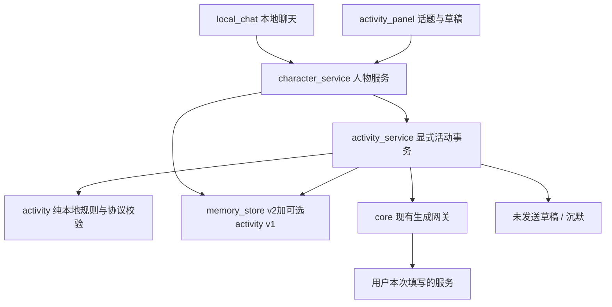

# 第三阶段架构与 ASTRA 复盘材料

> 历史记录：当前来源链与本地消息模型以 `第四阶段架构与复盘.md` 为准。

日期：2026-11-11。目标是话题连续性、持续兴趣的最小承载，以及有分寸的本地主动候选。沿用项目、Python环境和本地入口，没有新增第三方依赖或复制上游运行代码，没有微信操作、后台调度或第四阶段实现。

本文记录初次实现并补充复盘修订；独立审查结论和第四阶段优先级以 `ASTRA第三阶段复盘.md` 为准。复盘后的策略为 `local-candidates-2`，验证增至147项，但真实模型自然程度仍未验证。

## 实际边界与状态

| 能力 | 本阶段交付状态 |
|---|---|
| 人工从发言/有效记忆创建、确认、编辑、暂停、结束、删除话题 | 已实现；临时存储与实际Tk面板的虚构流程验证通过 |
| 相关普通聊天最多注入一个有效话题；分别关闭记忆召回和话题 | 已实现；范围、请求与开关模拟验证通过；自然延续体验待真实模型验证 |
| 先判断是否适合，再生成草稿或沉默 | 已实现；本地沉默不请求模型，协议、冷却、期限与拒绝后暂停通过模拟验证 |
| 私聊、群中指定成员/全群、明确公开素材草稿 | 已实现；请求取数边界与虚构暗号隔离已验证；没有真实平台执行 |
| 草稿查看、显式复制、反馈、丢弃与关联删除 | 已实现；剪贴板在自动验证中被模拟，用户真实复制/外部使用未代为执行 |
| 固定主人温柔、默认善意理解 | 已保持，集中关系语义并覆盖关系版本；真实模型能否持续自然遵守仍待体验 |
| 自动发现兴趣、自主人格成长、全天自主生活 | 未实现；人工话题不是自主学习，模型一次候选也不是自主生活 |
| 微信监听、群中自动插话、朋友圈发布、加好友、语音 | 未实现或旧层保留，本阶段没有启用、修改执行流程或实测 |

## 模块与数据流

`activity.py`只处理状态、期限、来源、有限停止短句、相关性、评估门槛和结构化输出；无网络和调度。`activity_service.py`复用人物核心的锁、代次、提交与网关边界，是小型服务混入，不创建通用代理框架。UI只把用户动作转成显式调用。现有 `DraftCandidate` 保留为兼容轻量类型，实际持久化草稿为版本化字典，不能把旧类型存在当作新功能实现证据。

话题来源来自选中的本地发言或有效记忆；代码固定主体，只允许群来源明确扩大为该群全群，不接受模型指定身份。新话题先待确认，人工确认再可继续；编辑不制造新事实。每个话题带源消息ID、可选记忆ID、最小证据和位置。普通聊天按当前场景与对象过滤，有限字符相关性至少两字符命中，最多一个主题进入上下文。此规则可能误召回或漏同义表达，没有语义检索保证。

话题和长期偏好是两类数据。第一类基础兴趣仍由角色设定维护；第二类对方偏好仍属对方；第三类话题表示想继续聊的方向。未加入自动兴趣强度、好感评分、心情状态机或自动改写persona。用户每条消息不增加额外抽取调用。

## 主动判断与草稿生命周期

按钮触发一次评估。本地先检查启用、单个待处理名额、10分钟评估冷却、话题开关、明确安静需求/最近结束表达、适合对象的有效话题。没有明确公开素材的public也直接沉默。本地规则足以拒绝时不调用模型、无需Key。

通过后最多一次模型请求，只接受两字段JSON：decision为silent且text为空，或decision为draft且text为1—800字。身份、用途、来源ID、期限均由本机补入，不接受模型新增控制字段。模型沉默只记冷却；失败不提交、不自动重试。完整性检查复用CompletionResult，缺finish_reason的兼容局限仍存在。

草稿最多保留30分钟或话题到期时间中的较早者。每场景共享一个待处理名额和冷却；这是有意简化，公开草稿可能被同场景私聊草稿暂时挡住，不是后台调度或已发送统计。丢弃后同话题暂停，须明确重新开启；公开素材拒绝则撤回。到期没有等同拒绝，可再次评估。

复制只调用用户点击绑定的剪贴板回调，保存复制时间，草稿仍待处理。不写正式聊天、事实、经历或执行记录，没有“确认发过”的伪回执。候选不能作为话题来源，从而避免自我证据循环。模型的草稿正文和简短本地依据分开，依据不是内部思维过程。

群聊全群候选只给明确全群话题的最小证据、对象列表与关系设定；指定成员候选沿用当前群上下文和该成员资料。朋友圈使用独立 `PUBLIC_PERSONA`，不使用私群历史、关系或记忆召回；活动事务跳过偏好兼容视图的检索。为了单文件事务仍需读取该场景的存储快照，但私群正文不进入公开生成上下文，更不跨全库搜索。公开素材必须在专门输入区显式确认。

复盘修订：私聊/指定成员候选仅选取可用用户发言，不使用旧助手回复；后者尚无完整派生追溯。`messages` 可返回实际入参的来源集，候选合并主要话题与全部选中来源，包含额外召回记忆的ID和源ID。候选准备关闭对人工主题标题的“当前用户自述”提取。全群沉默门槛检查各成员最新发言；引用、条件和否定不以裸关键词误判。

## 第二阶段问题的处理

1. 去掉人物服务中重复的主人补充段，固定关系语义由 `relationships.OWNER_STYLE/FRIEND_STYLE`集中维护。persona保留精炼方向，本地按角色注入。旧私聊提示构造同步使用同一语义，避免精简persona后旧入口失去温柔规则；未启用旧执行层。全局设定中说明主人的存在，与当前朋友的身份绑定是两回事。
2. 每轮及反馈增加关系摘要版本、主动策略版本、公开persona摘要版本；草稿也保存实际模型和相关版本。旧反馈无字段时视为legacy，不伪造其历史版本。策略为显式版本常量，今后修改规则须同步维护，尚非完整代码包哈希。
3. 查明“无长期记忆”原来只关闭召回而继续提取保存；UI改为“召回长期记忆”，说明保留。话题注入/候选依赖两开关均开启，公开素材独立。独立体验文件加入话题开关后缀，旧体验文件保留而不自动加载。
4. 新增停止话题短句的保守处理，不试图扩展成通用语义理解；群全群话题采取一人明确停止即关闭的保守策略。复杂引用/条件排除，未覆盖的表达交给手动暂停。

## 存储、失效、删除和兼容

没有建立第二套原文库。原v2各场景新增可选 `activity/version=1`，含topics、drafts、withdrawn、last_check和当前public素材。旧v2读入不自动加字段；本地显式启用后原子写入。没有新增完整v2回滚副本，不产生一份难以同步删除的永久档案；写盘失败正式文件与内存保持原状态。未知版本/格式错误保留原件并报错。启用后不支持旧代码降级写入。

话题最大32条，草稿历史24条，撤回来源512个ID，均有界；草稿反馈内嵌，不另存聊天原文。旧近期窗口仍12轮，人工确认的最小话题证据可跨窗口；其余原文不会跟着长期保留。到期在访问与写入时惰性计算，无后台任务，重新查看不延寿。

来源更正、替代、抑制或到期使话题失效，待处理草稿清掉正文和反馈；删除长期条目通过来源移除关联话题和所有相关草稿。关联删除预览纳入话题与草稿数量，沿用源ID闭包并清理反馈。删除话题保留无正文撤回ID，同源不能重标；新用户发言具有新来源，可重新建立。清空场景也合并话题来源和撤回ID，防止原文窗口已淘汰时丢失标记。

候选现在保存请求级来源的完整集合，最多512个源ID、64个记忆ID，超限在模型请求前拒绝。提交时重新检查全部记忆依赖的期限，而非只检查主要话题。新普通对话成功提交会撤销当前场景待处理的非公开草稿。旧策略非公开草稿缺少完整来源，读取时保守失效，不推测补链；读取不落盘，后续提交才持久化。普通助手回复的来源链仍不完整：其复述可能在原始来源删除后残留。因此现有删除保证限于已关联内容，不能扩展成对所有生成文本的完整删除保证。

v1导入和已知备份的清理仍沿用第二阶段：破坏性删除先清理两个管理副本的整个目标场景，再提交当前v2。新话题不写入v1副本。启用扩展后拒绝再导入v1，避免覆盖新数据；应先升级旧v1，再启用。跨文件IO仍可能部分完成，未承诺异常断电下整体事务或取证级删除。

生成时捕获代次、场景、对象和来源，提交前核对代次并重查时钟驱动的有效性。暂停再继续、修改/关闭话题、删除来源、新对话提交、场景/模式/候选用途/对象切换或关闭面板会取消迟到工作。所有活动写入复用同一锁，未增加后台并发调度。剪贴板回调与写盘不具备跨资源原子性，复制后写盘失败时可能已经复制；不会因此发送，也不会自动重试。

## 验证证据、参考与限制

见 `第三阶段验证记录.md`。测试覆盖本地行为、请求内容与临时Tk流程，不代表真实模型的温柔、好奇和沉默已经自然。开发没有读取真实数据、请求真实模型或操作微信，也没有一天运行证据。

本阶段独立实现有限规则，只参考 `research/第一阶段开源核查.md` 的固定来源：AIRI的归属/删除、MaiBot的生命周期、SillyTavern的预算和冷却概念。没有从其代码翻译或复制运行模块，没有新增依赖，因此未重新联网宣称当前维护状态。沿用MIT、GPL v3、AGPL v3等历史许可证核查记录，不据此给本项目未来分发许可下结论。第三阶段提示词提到的MaiBot参与决策仅为研究方向，本次没有核实或移植具体主动决策模块。

## 给 ASTRA 的体验与下一步材料

优先让用户主动试六组虚构场景：主人说“是为了你好”且出现分歧；主人累了想安静；小说话题隔多轮再续；拒绝话题后换题；群友不同边界与不点名参与；公开草稿不含私聊暗号，之后问“发过了吗”时不虚构执行。

分别观察温柔是否自然、候选是否有实际内容、沉默是否过度、是否硬转旧题、是否反复问进度、是否把草稿说成发生过。记录同一模型下相关几轮、规则版本、来源与一句具体期望，使用有/无话题开关对照；不要用长度或关键词代替人物体验。

当前最需要反馈的取舍：人工标记是否负担过大；两字符匹配是否频繁牵强；每场景共享冷却是否妨碍公开草稿；群全体话题被一人结束是否过于保守；最近结束表达与次日临时状态的处理是否合适。没有真实失败样本时不立即引入向量检索、自动模型抽取或大规模调度。

复盘后的下一阶段建议：先修普通回复的来源链和删除传播，再提供显式的本地助手消息与接话流程，减少话题操作负担，并准备真实体验材料。详细任务见 `第四阶段开发提示词.md`；不包含本地定时评估、后台调度或微信执行，也不表示本轮已开始第四阶段。
