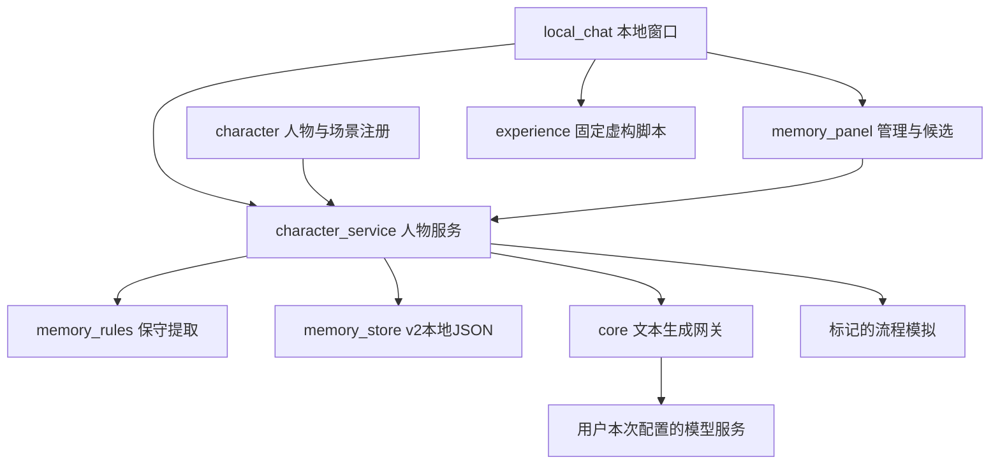

# 第二阶段架构与 ASTRA 复盘材料

日期：2026-11-11。阶段目标为“选择性记忆与自然表达验证”。基于原项目继续实现，没有建立新仓库、引入代理框架或进入微信操作。开发分工未用于改写运行时模型或配置。本阶段到此交付，第三阶段尚未开始。

## 已落实的第一阶段问题

| 原问题 | 改动与验证 |
|---|---|
| 成功回调清空生成期间的新草稿 | 窗口用请求ID、发送文本及草稿版本核对后才清空；成功、失败的延迟模拟都保留新输入 |
| 半截正文被截成1800字并提交 | 网关提供CompletionResult并保留finish_reason，不静默截断；length、异常状态、空正文及超长回复拒绝提交 |
| 主人全部偏好被排除 | 主人普通偏好与朋友共用记忆流程；只有改变主人身份/温柔基调的互怼偏好受到固定保护 |
| 否认句仍被识别成接受玩笑 | 完整短子句匹配，并先排除否认、引用、条件、转述等；复杂句保守不提取 |
| 证据附带无关内容 | 保存支持记忆的片段与源消息位置；虚构暗号在近期窗口淘汰后不再留在长期证据 |

旧`complete_chat`字符串接口保留供原适配器使用；它也不再静默截断。旧入口保留此前的提供方选项，新本地入口默认只发送标准参数。没有修改既有API地址、模型、密钥或旧监听配置。

## 当前模块边界

`character.py`保留原公共入口、固定人物/场景与兼容类名；`character_service.py`集中生成、提取、提交、修正删除和反馈事务；存储与规则拆成小模块。保留原persona和关系表达规则，`relationships.explicit_preferences`转用同一套保守提取规则，避免新旧入口两份识别逻辑长期分叉。纯Python模块导入不打开微信或桌面适配器。

继续使用JSON的理由：固定少量本地场景、单窗口单请求、数据量有上限，整场景快照与原子替换已足够。没有为了“长期记忆”引入向量库、图数据库、云存储或大型框架。可替换提取器与存储的边界由现有小函数/类承担，不建立一套空插件系统。

## 记忆如何工作

可信范围先由场景注册选择，再读取该场景快照，随后按当前人物、状态和到期时间过滤，最后用有限关键词相关性排序与预算裁剪；默认不跨场景共享。相同人物在私聊和群中的信息依然分开。主人固定身份不存放在可修改记忆里。

近期窗口是12轮完整本地对话；发给模型的近期正文预算16,000字符。长期记录包含稳定ID、人物/场景、类型/槽位、简短内容、来源、状态、时间、到期时间、修正关联及最小证据。证据包含来源轮次ID、片段和起止位置。只有用户原话的有限明确自述自动提取；模型回复不写作人物事实。

支持边界、语气长度、简短喜欢/不喜欢、咖啡口味及有限的“今天”临时状态。复杂表述和重要经历可从一轮用户发言手动标记，先成为候选；候选批量确认后召回。人物由该轮发言者固定，范围不可在候选正文里扩大。事件加“本地对话提到”前缀，确认是保留决定，不是核实现实经历。

没有通用LLM抽取、自动事件重要性判断或自动性格推断，因此每轮只有原本的回复请求，没有暗中额外提取费用。手动候选是已经可用的功能，不是接口占位。

临时状态到Asia/Shanghai次日零点到期；时钟可注入。读取时根据时间计算状态，重启不重置截止时间；后续写入会持久化计算后的状态。召回不延长寿命。临时同槽位例外遮盖稳定值，不覆盖它；例外到期后原稳定偏好继续有效。

同槽位新自述可替代旧值；显式“更正”记录为corrected，普通改变为superseded。有限历史仍可在面板查看，但不作为当前事实召回。对这些来源、到期和不再召回来源的旧轮次，当前采用整轮不注入模型的简单策略，避免旧原话影响当前判断。代价是同轮其他无关内容也可能暂时缺席；没有秘密改写历史原文。

稳定边界、语气和当前临时状态优先注入；其他资料有相关话题才取用。同源原文已经在近期上下文时，普通自述不重复作为长期资料注入；边界/临时规则仍可明确注入以保持有效。每轮保存简短召回依据与条目ID，不记录模型内部思维过程。排序采用轻量词形/字符相关性，可能误召回或漏掉同义表达，尚无语义检索质量保证。

默认每场景256条记忆、32条候选；每条3段证据、最多64个完整来源ID。达到重复证据来源上限时不丢掉原始来源链；去重和删除标记各10,000个ID上限。容量满优先清理有限历史/到期记录，并保留来源标记；仍不足时停止新增相关记忆并提示，不以丢标记换容量。数值是可调整设计选择。

## 生成、修正和删除的提交边界

人物服务维持“快照 → 生成 → 检查取消代次 → 同步提交对话及提取结果”。暂停票据在派发前捕获；记忆修正、候选确认、删除和清空都会让在途结果失效。存储先校验快照，再原子替换文件，成功后更新内存。失败不会留下已保存回复却没保存记忆的半轮状态；已发出的HTTP请求仍可能计费。

同源重复提取通过processed去重；拒绝/删除通过blocked保存不含原文的来源ID。不会因重启、重放或再次标记旧轮次复活，后来主动提供的新发言可以作为新来源。

三种语义在UI区分：不再召回保留记录；删除长期条目去掉条目和证据但保留近期原文；关联删除以源消息关系求有限闭包，移除关联记忆/候选、整轮原文及反馈。后两项保留来源ID，不承诺服务商、系统备份或取证级删除。没有应用自己的摘要、向量索引、隐藏原文档案或常驻检索缓存。

v1不自动加载。窗口明确升级后，保留v1原件与已知备份，v2只把旧偏好作为无旧原文证据的待审核候选。后来对已升级模式做删除/拒绝/清空，为防v1恢复，会清空两个已知v1副本的**整个目标场景**，UI先说明范围。新存储仍保留其他场景。跨文件无法用一次文件替换实现整体原子事务，所以先清理已知旧副本再提交v2；中途失败明确报告未完成，保留v2当前状态并允许重试。没有声称异常断电下多文件事务已验证。

## 自然表达的验证入口

固定虚构脚本覆盖主人关心、主人偏好更正、朋友不同边界、私群隔离、临时状态及否认。脚本逐句载入输入框，用户核对后主动发送，不自动运行付费评测。独立体验区按脚本、模拟/API、有/无长期记忆隔离，可用同一配置做人工对照。近期上下文仍可提供短期记忆，因此长期效果需要将原信息推过12轮窗口后再观察。

反馈绑定选中的近期轮次，记录问题标签、一句期望、模型ID、人格摘要版本、脚本ID、记忆开关与该轮召回条目ID；不复制整段聊天，不保存密钥。最多30条并随原轮次淘汰，关联删除也一起移除，避免评测变成另一套无限原文档案。

persona没有因本阶段机械检查而继续叠加禁令，也没有加入随机情绪或多轮自动改写。此次复盘只增加一条关系语义，并同步到`OWNER_STYLE`与主人场景注入；朋友场景不会获得主人善意默认规则。尚无实际用户的第二阶段体验反馈，不能声称自然程度得到改善；当前已经做到的是让真实模型体验和本地反馈有明确入口。

## 交付状态

| 能力 | 状态 |
|---|---|
| 草稿保留、完整响应校验、主人普通偏好 | 已实现，虚构单测与临时窗口流程通过 |
| 主人善意默认与温柔分歧处理 | 已实现，人物设定、关系提示和主人/朋友作用域测试通过；真实模型表达仍待体验 |
| 选择性规则记忆、手动事件候选、修正、到期、范围隔离 | 已实现，虚构数据和可控时钟验证通过；通用语义提取未实现 |
| 查看证据、批量确认、删除及防重放、v1明确升级 | 已实现，临时文件验证通过；真实用户文件未读取、未自动迁移 |
| 虚构脚本、独立体验区、体验反馈 | 已实现，模拟界面验证通过；真实模型/日常用户体验待验证 |
| 长期人格成长、自主兴趣、主动表达、朋友圈候选计划 | 未实现；原有DraftCandidate仍只是后续类型，旧本地朋友圈草稿不在新入口启动 |
| 微信监听、回复、加好友、朋友圈发布 | 本阶段未启动或开发；旧操作层保留 |

没有新增第三方依赖，也没有复制开源运行代码。继续参考第一阶段固定来源中的AIRI归属/删除、mem0范围、MaiBot生命周期及SillyTavern预算设计；本阶段没有采用具体上游模块，因此未重复联网宣称当前维护状态。原许可证核查仍是其记录日期的证据，不是未来分发许可结论。

## 给下一次 ASTRA 复盘的重点

首先体验六项：主人偏好跨窗口仍有用；主人明确表达为小泽好时，小泽是否温柔接住而不突然怼主人；主人暂时不同意时，是否先善意理解再诚实澄清；不同朋友的边界不同；更正与临时状态不会混淆；私聊不会自动进群。再看记忆是否被自然使用，而不是照着档案说话。请携带具体前后几轮和一句期望，不用测试数量替代表达结论。

主要取舍及限制：

1. 选择规则+人工标记保证小范围可解释，牺牲复杂句覆盖率。若用户频繁手工标记，可再决定是否加入显式触发、证据校验的模型提取。
2. 采用完整源ID和整轮删除简化血缘，可能比用户直觉删得更多；UI有影响预览。若今后加入摘要，需要先设计派生来源关系，不能只在主表删记录。
3. 暂不跨场景共享，即使是同一个人也分别了解；未来公开共享需要用户明确授权，不能仅靠昵称或模型判断。
4. 采用整轮隐藏处理更正、到期和抑制，可能损失同轮其他上下文。若真实体验经常因此断话，可考虑保留非冲突片段，但应先取得实际例子。
5. 有/无长期记忆体验区分开，但模型本身仍有随机性；小样本只能发现问题，不能证明人格稳定性或长期关系体验。
6. “主人为小泽好”采用默认善意解释，而不是事实判断或服从开关；若真实对话出现过度迎合、忽略风险或反复把主人解释成恶意，应先收集具体轮次，再调整措辞，不继续堆叠绝对化禁令。

下一阶段是否进入持续兴趣和主动候选，应以真实体验为前提。若核心记忆仍频繁误提取或生硬复述，先修正第二阶段质量；若基本稳定，再考虑局部兴趣/话题连续性，以及用户主动请求生成、允许沉默的本地主动候选。此处只是复盘建议，未开始第三阶段或微信操作。
