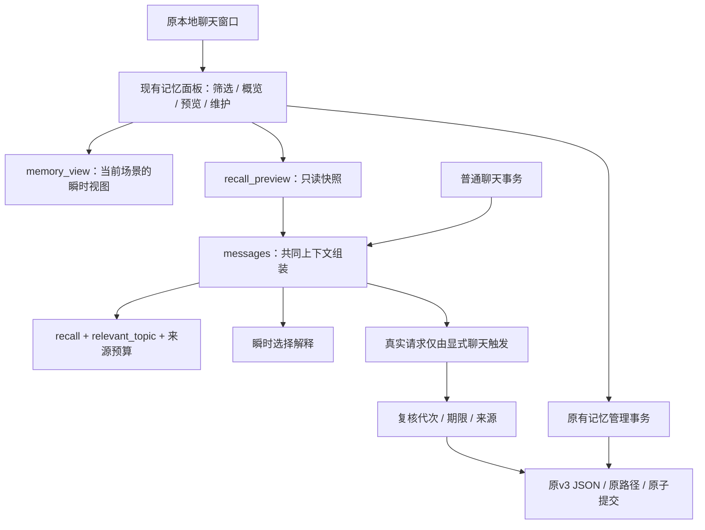

# 第五阶段架构与复盘材料

日期：2026-11-11。按第五阶段任务书，在现有库、人物服务和窗口上实现“本地记忆库可用性与多轮体验优化”。没有读取用户既有记忆/微信记录/配置或Key，没有真实模型请求、微信、后台调度、上传、发布或第六阶段开发。

同日后续ASTRA复盘已修订维护/预览/反馈边界，当前结果为186项回归通过，详见 `ASTRA第五阶段复盘.md`。下文179项为初次交付历史。按用户新授权已生成 `第六阶段开发提示词.md`，尚未实施；下文“暂不生成第六阶段”仅表示初次交付时的范围。

## 交付状态

| 项目 | 状态及证据边界 |
|---|---|
| 当前模式/人物范围、筛选、证据搜索、容量及空结果区分 | 已实现，虚构场景和实际临时Tk流程通过 |
| 易读证据、更正链、瞬时人物概览 | 已实现；不保存新传记、不推断性格、不增加好感分 |
| 共同取数的离线召回预览 | 已实现，实际请求捕获、字节/状态对照、真实线程并发验证通过；不是历史请求回放 |
| 按ID维护、筛选不转绑、写盘失败保留编辑 | 已实现，临时Tk真实回调和合成IO故障通过 |
| 三组逐句脚本、四类记忆反馈、临时跨窗口样例 | 已实现，虚构模拟通过；用户仍需主动触发每次真实请求 |
| 真实模型的自然、温柔、主动分寸、长期相处效果 | 本轮没有用户样本，待体验；不能用179项回归替代该结论 |
| 更强语义检索、自动抽取/兴趣/性格成长、持久免打扰 | 本阶段未实现，仅作为以后有证据时讨论的方向 |
| 微信操作与后台主动调度 | 未开发/未启用；在本阶段交付后停止 |

## 结构与职责

`memory_view.py` 是新增加的薄视图模块，输入必须是一个授权场景快照，组合筛选、计数、概览、证据文本和预览展示。不读文件、调用模型或保存画像。搜索只查记忆正文及最小证据，不额外搜完整历史、其他场景、私聊或旧微信数据库。群内原话是共同上下文，人物长期资料仍按当前成员取用；两者在界面中明确区别。

`memory_panel.py` 沿用原窗口，按四个页签分开维护、概览、预览和标记。顶部显示固定捕获的模式/场景，人物筛选明确；预览有自己的目标人物与问题框。默认有效，候选和历史/到期有明确入口。维护收敛为单条ID，避免批次多次写入中途失败造成“全部成功”的假象；这是可调整的交互取舍，本阶段没有新增批量事务。

编辑框把内容与原条目ID绑定，不因筛选/刷新/选择另一个人而改绑。保存要求仍选中该ID；写失败保留输入。提交成功与后续绘制失败分开报告。标记后切到来源人物候选区，确认后切回有效区并按同ID定位，不自动选择下一条。搜索/刷新不调用invalidate或写文件，也不改变下轮行为。

## 预览与真实请求的关系

不是另写检索器：`memory_store.recall` 和 `activity.relevant_topic` 新增可选诊断出口，原返回接口不变。`character_service.messages` 在同一次实际选择过程中记录长期注入/近期去重、话题与历史选择，沿用原来的排序、字符/数量预算、来源合并和完整省略策略。默认仍发布旧last_trace供正常聊天使用；`recall_preview` 明确设置 `publish_trace=False`。

预览在锁内取得当前授权场景的深拷贝，随后只在副本计算到期、话题有效性和取数。它不进入request_slot，不改epoch/paused/inflight/last_trace/last_notice、不保存、不提取输入、不执行话题停止、不延长期限或冷却。为与真实新输入的来源预算一致，预留一个仅存在于此次计算的新输入根ID，不写入来源链或正式文件。

基础资料超过来源预算时，真实请求仍在模型前拒绝；预览报告同一拒绝，并把原拟选择内容标为未实际提供。旧助手完整来源放不下时保留用户原话的独立判断，省略对应助手正文，不截断链。未知来源旧正文明确隔离、不补链。预览文本只呈现ID和选择解释，不显示完整系统提示、完整请求或模型思维。

预览不处理新输入中的新事实/停止表达，避免一次查看变成隐藏记忆提取。真实exchange仍先在事务副本中处理当前输入，再共同组装，因此两者是“同一快照下的已有资料选择规则一致”，不是承诺任意输入发送后完全相同。时钟和维护变化也可能改变选择。当前预览和过去真实证据不混写；反馈窗口单独显示所选轮次已经保存的reply_trace依赖，不用当前快照伪造历史诊断。

## 存储、兼容与数据副本

正式库路径、顶层version=3、reply_trace/version=2、activity/version=1及候选策略 `local-candidates-4` 全部保持。没有新增持久化字段、迁移、全文请求日志、模型失败原文库、向量索引、概览摘要或全量备份。新反馈仅扩展既有tags的允许值，沿用原30条、note300字和轮次/版本/删除绑定；旧标签仍可读。旧程序可能不认识新标签，不能以“顶层版本相同”保证降级写入兼容。

原有v2只读/显式升级、v1管理副本整场景清理及跨文件非原子限制保留。内存只读投影可以显示到期，但不会为了查看重写文件；下一次正常写入仍按原规则持久化状态。删除的全根来源链、更正记录与raw_source_ids区分、话题revision_id、不截断来源、暂停和单请求保证没有放宽。

容量保持：12条近期容器、16,000近期正文字符、最多6条/1,800字符长期正文；256记忆、32候选、每条3段证据/64源ID、processed/blocked各10,000；128请求根/32记忆依赖/16话题版本；32话题、24草稿和既有期限/冷却。停止召回不释放条目，确认也不减少总数；删除条目不保证释放来源标记预算。面板和说明书不把这些情况混称“记忆满”。

`stage5_demo.py` 是可选的原UI启动包装，在新临时目录为模拟/API各自造虚构样例。只用合成completion推过近期窗口，展示前重新加载；不复制真实库、搜Key或调用模型。再次准备遇已有模式文件直接拒绝覆盖；窗口关闭由TemporaryDirectory清理。样例模拟回复有显著标记，API仍需用户当次配置并点击。两个虚构模式不是正式数据备份或新的评测档案。

## 本轮优化的依据与限制

原面板主要显示原始JSON、全部状态混排，缺少检索未选解释；simpledialog的失败重试无法保留已关闭对话框中的改写，旧多条列表操作也难以表达部分成功。这些依据代码检查改善，并用虚构IO故障和实际Tk回调验证。没有假称从用户真实聊天里发现了新的误记/口吻问题，没有调整persona、固定主人规则、提取规则或运行时API来填充“优化”数量。

本轮验证能证明：作用域正确、选择解释与实际请求一致、查看不写状态、更正/删除可继续聊天、失败保留编辑、在途与暂停保持原提交规则。仍不能证明模型真正在意每条已提供资料、隐含偏好理解正确、每段话都自然温柔，或长期相处像真实人物。字符相关性可能漏同义词或误召回；请求级保守来源可能使过多助手内容失效；人物概览只汇总有效条目，不等于模型性格理解。主窗口与新面板仍未覆盖所有DPI/系统主题、多进程和崩溃情形。

## 给6 ASTRA ULTRA的阶段复盘材料

先区分四种问题，避免用“换数据库/加人格提示”解决不同原因：

| 观察 | 优先核对 | 后续判断 |
|---|---|---|
| 记错了 | 最小证据、人物/场景、状态、更正链 | 若有限规则确有误提取，用虚构复现后局部修规则；没有资料不补编 |
| 记着但这次没选中 | 当前预览的相关性、同源原话、开关及预算；过去以该轮来源证据为准 | 反复漏同义表达才考虑检索改进；上下文缺席不直接归为人格缺陷 |
| 已提供但表达生硬 | 该轮来源ID与实际几句体验、是否重复追问/播报 | 这是模型表达问题，优先小范围提示或请求结构，不扩大记忆存储 |
| 没有对应资料 | 是否仅是普通寒暄/未命中有限规则，是否需要手动标记 | 先决定是否值得保留，不能承诺自动记住所有事情 |

请用户体验三组：8轮主人连续交流和温柔分歧；临时虚构样例的一轮咖啡召回及面板更正；朋友不同边界、全群开口采用接话和明确停止。记录一个具体问题的标签及一句期望即可，版本绑定已有；不上传整库/Key或建立永久失败原文副本。

目前真实证据不足以决定第六阶段实现什么。若重复出现同义查询漏召回，再评估小型相关性改进；若资料已提供仍生硬，再定位表达；若停止边界持续失效，再单独规划持久免打扰或精细话题归属。暂不引入这些功能，不自动生成第六阶段任务，也不以没有样本为由一直等待。

没有新增依赖或复制第三方代码，没有重新联网核查上游，也不宣称AIRI/MaiBot/Letta等当前维护或许可证状态已重新核实。沿用第一阶段研究记录的历史日期。本阶段在交付后停止，微信和后台调度仍放到以后独立设计。
