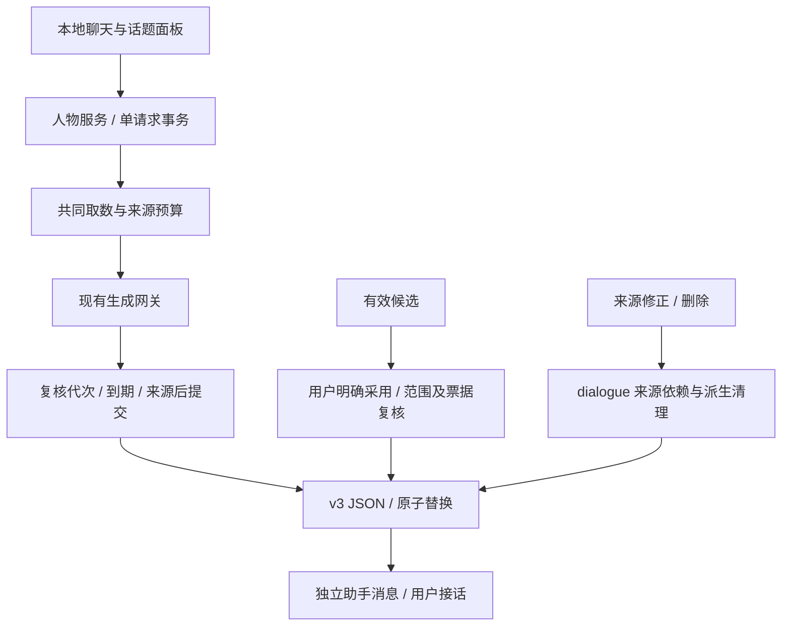

# 第四阶段架构与复盘材料

日期：2026-11-11。基于现有项目完成来源追溯、有界传播与本地采用。没有新增依赖、改运行时API/模型、读取真实数据、启动微信或后台主动调度。

同日ASTRA复盘修订：详见 `ASTRA第四阶段复盘.md`。新reply_trace为version=2，保留全部删除祖先source_ids并另存实际原话raw_source_ids；v1保守兼容。话题增加按每次变更更新的revision_id，避免暂停再开启恢复旧摘要。共享场景过滤和普通UI完成回调恢复已修复；当前回归167项通过，真实语言体验仍待用户主动验证。

## 结果与状态

| 能力 | 状态与证据边界 |
|---|---|
| 普通回复的实际请求来源与多跳传播 | 已实现；虚构持久文件、请求捕获、窗口淘汰与重启验证通过 |
| 更正/抑制/到期与删除派生正文 | 已实现；请求级保守依赖，不是逐句语义溯源；明确删除可保留无关用户原话 |
| 有效草稿成为独立本地助手消息并接话 | 已实现；真实临时Tk回调、模拟网关验证通过；没有假用户输入或平台回执 |
| 重复采用、写盘失败、显示失败恢复 | 已实现；模拟文件失败和Tk渲染失败验证通过；不承诺跨资源事务 |
| v2只读、显式升级v3、旧助手历史隔离 | 已实现；虚构旧文件测试和窗口升级通过；未迁移任何用户实际文件 |
| 选原文片段、预填表单、标记并确认 | 已实现；用户仍明确选择证据和确认，不是自动话题发现 |
| 真实模型自然程度、长期相处效果 | 未验证，准备了脚本供用户主动体验 |
| 微信、后台定时、自动兴趣成长、语音 | 未实现/未启用；没有进入第五阶段 |

## 数据流与结构

新增小模块 `dialogue.py`，负责来源校验/合并、有效性、话题内容摘要、派生正文清理和近期容量。不建立代理框架、事件服务、数据库或隐藏日志。普通生成和指定对象候选共用 `messages` 的选择路径。

普通轮次仍为 `kind=local_exchange`，用户 `text` 与助手 `reply` 在语义上分开。生成内容保存 `reply_trace/version=2`：本场景ID、完整根来源ID、实际读到的原话来源子集、实际注入的记忆ID、话题内容摘要。助手复述的来源被传递合并，模型自己不选择范围或声明来源。当前用户先在事务快照中提取有限自述、分配稳定源ID，再构造请求；生成失败不会提交快照。旧version=1沿用全部来源可能均为原话的保守解释，不猜测补链。

`kind=local_assistant` 是独立本地开口，`text` 为空，不伪造用户输入；有target、draft_id、正文、来源和版本。群助手请求以包装内容标明target，后续用户仍按自己speaker_id处理。用户资料只从用户发言提取，标记来源列表也排除助手消息。

## 有界来源与删除取舍

每份来源最多128个根ID、32个记忆ID、16个话题版本。先计算当前用户/近期用户/注入资料的来源，再从最近助手内容向前尝试合并；一条助手内容完整来源放不下，就在模型请求前排除这条内容。基础资料已经超限则明确拒绝，不发送模型。没有无限追加历史ID，也没有截断链后继续承诺完整追溯。

根ID可跨近期窗口存续但无原文；12条近期容器是唯一普通正文存储。保留的记忆/话题最小证据按自身期限存续。128根边界意味着长期传播会出现上下文断点，不能解释为小泽自主遗忘。当前没有向量检索或摘要替代。

话题版本使用title/direction/quote/来源/状态/时间等内容的短摘要，不只看更新时间；可控时钟中同一时刻多次编辑也不会复用旧正文。人格/关系版本独立于对话来源，不因固定主人设定把各场景串成一个删除闭包。

失效通过来源/记忆状态和话题摘要判断，停止注入而保留维护历史；明确删除通过完整根依赖清理助手正文、召回元数据和反馈，并移除相关原话/记忆/话题/草稿。后续无关用户原话保留。删除长期条目本身保留近期用户原话，不能承诺模型完全无法再次理解；当前撤回标记也会过滤这类旧源原话。用户之后新发言可作为新证据，助手自述不能。

这是保守请求级追溯：某信息仅出现过也可能导致整段助手文字失效或清空；不精确定位复述短语。相同长期记忆多证据沿用既有闭包，关联删除可能包含多次用户自述，预览按实际范围展示。无来源的旧助手正文无法证明无关，破坏性删除保守清理本场景所有这类正文和反馈，保留其无关用户文字；该范围必须先说明。

已采用的消息不再受草稿30分钟期限支配，但其来源失效后不参与生成；本地事件位置仍保留，不能因内容失效伪称从未加入过。正文明确删除后保留空占位和有界元数据。草稿正文采用后清空，避免双份正文长期存在。

## 提交、失败和兼容

`request_slot` 在服务层限制一个在途普通/候选请求，即使绕过UI也拒绝第二请求和同时采用。暂停、修改、删除和界面选择变更推进代次；提交前复核时钟、来源和代次。用户在HTTP期间操作仍可能计费，不重试或自动续写。

采用在同一次场景提交中追加消息、消费草稿和转移反馈。重复采用查询draft_id/采用回执，在有界历史中不重复创建；即使元数据和消息以后都淘汰，旧ID不存在时也只拒绝，不重建。UI把持久化错误和之后绘制错误区分：写盘失败不报成功；提交后显示失败只报告刷新问题，再次展示从现有事件恢复。

内部顶层升级为v3，文件名仍保留 `*-v2.json` 以兼容路径。新存储为v3，既有v2仅只读加载；明确升级入口原地原子替换，无完整新增备份，旧助手不猜来源。所有写入与管理中v1清理都先要求可写版本，防止绕过v2只读而改副本。未知结构失败保留原件。旧写入程序拒绝v3，不能降级写。

管理中的v1副本清理仍为跨文件先清理再提交，支持失败重试但非整体断电事务。正式启动器单实例锁仍有用；没有多进程数据库锁或压力测试。Tk绘制与文件提交、剪贴板与文件提交均非跨资源原子。

## 实现范围和开源

新增 `dialogue.py`、`test_dialogue.py`、`smoke_dialogue_ui.py`；更新人物服务、存储、活动逻辑/面板、本地时间线、记忆预览、反馈、体验脚本和阶段文档。第三阶段候选隔离测试调整为允许有效新助手历史，保留“已删除暗号不得进入请求”的核心断言。旧v1助手反馈仍可维护，来源不明内容不会进入生成，并在破坏性删除时一起清理。

没有新增依赖、复制第三方实现或重新核查上游；沿用既有研究背景，不宣称AIRI/MaiBot等当前维护情况已核实，没有发布或上传。人物温柔关系保持现有集中规则，没有继续堆提示词或引入随机情绪。

## 给6 ASTRA ULTRA的复盘重点

优先体验：选小说片段到本地开口的操作是否足够轻；接着回答是否自然，是否重复追问；主人善意分歧是否温柔而诚实；朋友/群内对象是否清楚；记忆更正后是否仍引用旧事。使用第四阶段固定脚本与独立体验区，记录模型/规则版本和一句具体期望，禁止把流程模拟当自然程度证据。

关键取舍是可解释、有界和保守撤销，而非精细句子依赖。应关注128来源预算触发时是否明显断话、修正一条偏好是否影响过多助手历史、旧助手删除范围能否理解。真实失败样本出现后再考虑更细的消息分段或更好的上下文选择，不默认扩大基础设施。

仍有限制：话题相关性靠字符规则，停止表达可能结束多个话题，最新发言判断并非持久免打扰状态；丢弃后不保存独立负反馈摘要；没有自动兴趣发现或真正的全天主动行为。当前不能自动判断“已阅读”或外部手动执行结果。下一次先收集真实本地体验再规划后续，本阶段到此停止，不启动第五阶段或微信操作。
